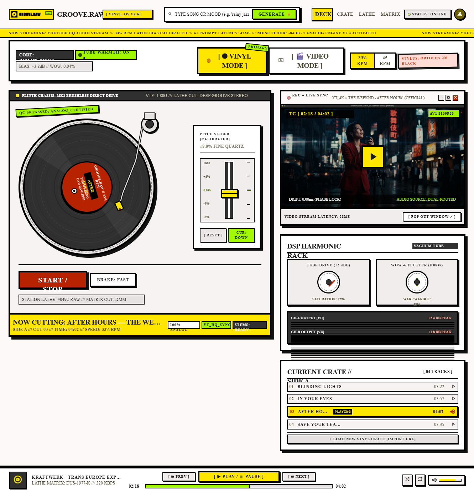

# GROOVE.RAW // VINYL_OS

An analog neo-brutalist vinyl record player web application with real-time YouTube audio streaming, spinning vinyl physics, scratching, crates management, miniplayer mode, and real-time collaborative jamming (**Groove Together**).



## Features

- **Analog Vinyl Turntable**:
  - Realistic platter rotation with 33⅓ and 45 RPM controls.
  - Interactive direct vinyl scratching / reversing via click-and-drag with real-time audio scrub.
  - Movable tonearm that parks/engages with playback.
  - Dynamic ambient lighting and vinyl label tints extracted directly from album artwork colors.
- **Groove Together (Collaborative Jam Rooms)**:
  - Generate a 4-digit alphanumeric code to host a jam room.
  - Invite friends to join with your 4-digit code.
  - Real-time synchronized queue powered by WebSockets (`ws`).
  - Isolated Jam Queue UI that does not interfere with or overwrite local personal crates.
  - Skip, reorder, play, pause, and add tracks in sync for all listeners.
- **YouTube Streaming & AI Search**:
  - Direct YouTube playback without third-party audio downloads.
  - Built-in YouTube scraper with optional official YouTube Data API v3 integration.
  - Optional Gemini AI integration for natural language prompt & mood resolution.
- **Crates & Playlist Management**:
  - Drag-and-drop songs from the search drawer directly into crates.
  - Browse, create, rename, and manage custom playlists.
- **Always-On-Top Miniplayer Mode**:
  - Document Picture-in-Picture (PiP) support that floats above applications even when the browser is minimized.
  - In-page fallback draggable floating player.

---

## Getting Started

### Prerequisites

- [Node.js](https://nodejs.org/) (version 18 or newer recommended)
- `npm`

### Installation

1. Clone the repository:
   ```bash
   git clone https://github.com/aadiljm2007-newG/Groove-Music.git
   cd Groove-Music
   ```

2. Install dependencies:
   ```bash
   npm install
   ```

3. (Optional) Configure environment variables:
   Copy `.env.example` to `.env`:
   ```bash
   cp .env.example .env
   ```
   Add your optional keys if you wish:
   ```env
   PORT=3000
   YOUTUBE_API_KEY=your_youtube_key_here
   GEMINI_API_KEY=your_gemini_key_here
   ```
   *Note: Neither key is mandatory. The player works out of the box with built-in YouTube scrapers.*

4. Start the server:
   ```bash
   npm start
   ```
   Or on Windows, double-click `start.bat`.

5. Open your browser and navigate to:
   ```
   http://localhost:3000
   ```

---

## Tech Stack

- **Frontend**: Vanilla HTML5, Vanilla JavaScript, Tailwind CSS (via CDN), Google Material Symbols & Google Fonts (Space Grotesk, Space Mono).
- **Backend**: Node.js, Express, `ws` (WebSockets).
- **Audio/Video**: YouTube IFrame Player API.

---

## License

MIT License.
